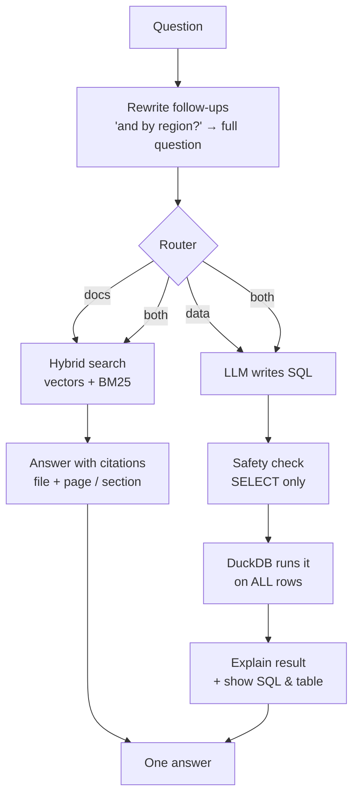

# Chat with your Documents & Data

One chat box for **PDFs, Word, Excel and CSV**. Ask about policies, ask for totals, or ask questions that need both.
It runs **100% locally, free and offline**: no API keys, no cloud costs, and your files never leave your machine.

> **Docs:** *"How many sick leaves do I get?"* → *"12 days per year [hr_policy.pdf, p. 4]"*
> **Data:** *"Top 3 regions by revenue?"* → exact numbers from **all** rows, with the SQL shown
> **Both:** *"Did North meet the Q3 target in the plan?"* → *"North sold 15 units [sales.xlsx, SQL] vs a target of 20 [plan.pdf, p. 2]"*

## How it works



| Route | Used for | How |
|---|---|---|
| 📄 **docs** | Policies, explanations, definitions | RAG: hybrid search (meaning + keywords), answers only from your files, with citations |
| 📊 **data** | Totals, averages, top N, counts, filters | Text-to-SQL: the LLM *writes* a query, DuckDB *runs* it on every row, so numbers are exact |
| 🔀 **both** | Compare numbers with targets or rules | Runs both and combines them in one cited answer |

**Why not RAG for spreadsheets?** RAG shows the model about 4 chunks, a keyhole view. It can't total 5,000 rows, and it will guess.
SQL computes over all rows exactly. Wide sheets (1000+ columns) work too: only the columns relevant to the question are sent to the model.

## Features

- **Files:** PDF, Word (.docx), Excel (.xlsx, every sheet), CSV, .txt, .md
- **Citations:** `[policy.pdf, p. 3]`, `[hr.docx, section 'Leave']`, `[sales.xlsx, SQL]`
- **Transparent:** shows the route taken, the rewritten question, the SQL and the result table
- **Strict:** answers only from your files; if something isn't there, it suggests questions that are
- **Follow-ups:** "explain with an example" or "and for South?" understand the earlier topic
- **Safe SQL:** read-only, single `SELECT`, no file or network access, query timeout, row cap
- **Offline:** works without internet once the models are downloaded
- **Tested:** 87 tests, including a full app test of all three routes (no Ollama needed to run them)

## Quick start

Requirements: macOS or Linux, **Python 3.10+**, **[Ollama](https://ollama.com/download)**, about 3 GB of disk space for the models.

```bash
chmod +x setup.sh run.sh   # first time only
./setup.sh                 # checks tools, creates .venv, installs packages, downloads models, runs tests
./run.sh                   # opens http://localhost:8501
```

Upload files in the sidebar (📄 documents, 📊 spreadsheets), pick what to search, and ask.

## Configuration

Copy `.env.example` to `.env` and edit it (all settings are optional):

| Variable | Default | Notes |
|---|---|---|
| `CHAT_MODEL` | `llama3.2` | `llama3.2:1b` is faster on older/Intel Macs |
| `SQL_MODEL` | same as `CHAT_MODEL` | `qwen2.5-coder:7b` writes noticeably better SQL |
| `EMBED_MODEL` | `nomic-embed-text` | If you change it, delete the data folder and re-upload |
| `DB_PATH` | `./chroma_db` | Where indexed documents and tables are stored |
| `HYBRID` | `1` | `0` = vector-only search, for comparison |

## Project structure

```
├── app.py            # Streamlit UI: upload, route, answer, show sources / SQL
├── router.py         # docs | data | both  (rules + a short LLM call)
├── rag.py            # Docs: chunk → embed → hybrid search → answer; rewrite & suggestions
├── data_agent.py     # Data: columns → SQL → safety check → DuckDB → explain
├── loaders.py        # Reads PDF, Word, text into sections with citation labels
├── tests/            # 87 tests: SQL safety, storage, router, loaders, RAG, full app
├── setup.sh / run.sh # One-command setup and start
└── .env.example      # Optional settings
```

## SQL safety (defence in depth)

The model writes SQL, so the app treats that SQL as **untrusted**:

1. **Text check:** one statement only, must start with `SELECT`/`WITH`; blocks `DROP`, `DELETE`, `COPY`, `ATTACH`, `INSTALL`, `SET` and file functions like `read_csv()`.
2. **Locked engine:** each query runs in an in-memory DuckDB with `enable_external_access = false` and `lock_configuration = true`, so even if a bad query got past step 1, it can't read or write files.
3. **Limits:** 15-second timeout and at most 50 result rows.

Your original files are never modified. Spreadsheets are copied once into Parquet files for fast querying.

## Running tests

```bash
source .venv/bin/activate
python -m pytest -q
```

## Troubleshooting

| Problem | Fix |
|---|---|
| `command not found: streamlit` | Use `./run.sh`, or activate the venv first |
| App says *Ollama is not running* | Open the Ollama app, then refresh |
| *Missing models* | `ollama pull llama3.2` and `ollama pull nomic-embed-text` |
| Wrong route chosen | Deselect the files you don't need, or name the source ("in the sales sheet...") |
| SQL fails or gives a wrong column | Open "Data used (SQL)" to see why; try `SQL_MODEL=qwen2.5-coder:7b` |
| Wrong numbers in an Excel sheet with formulas | Open and save the file in Excel once, so formula results are stored |
| Old `.doc` / `.xls` | Save as `.docx` / `.xlsx` |

## Limitations

- Small local models sometimes pick the wrong route or write imperfect SQL. The UI shows both so you can tell.
- Messy sheets (merged cells, several header rows, totals inside the data) need cleaning first.
- Joins across different files only work when they share a clear key column.
- Scanned PDFs and images aren't supported yet (no OCR).

## Roadmap

- [x] Multi-file RAG with citations, hybrid search, sentence-aware chunking
- [x] Follow-up rewriting and suggested questions
- [x] Word, Excel, CSV, text support
- [x] Router + text-to-SQL data agent
- [ ] Charts for data answers
- [ ] Re-ranking and an evaluation set with automatic scoring
- [ ] OCR for scanned files
- [ ] FastAPI backend + Docker deployment

## Author

**Jinka Kumara Swamy:** Python developer building AI engineering projects (RAG, agents, text-to-SQL).
